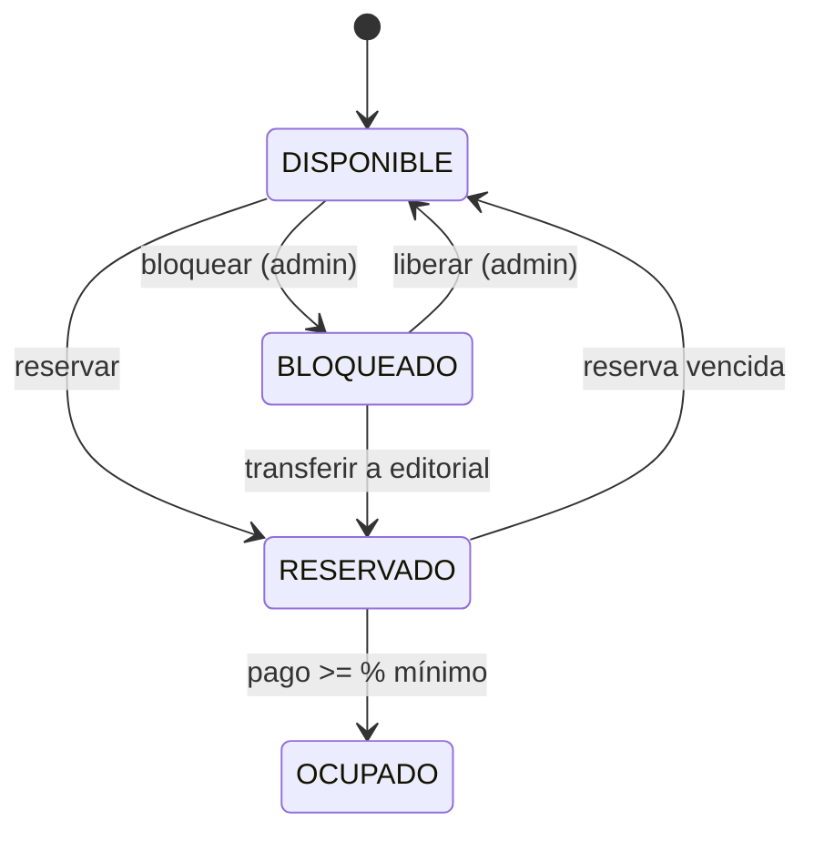
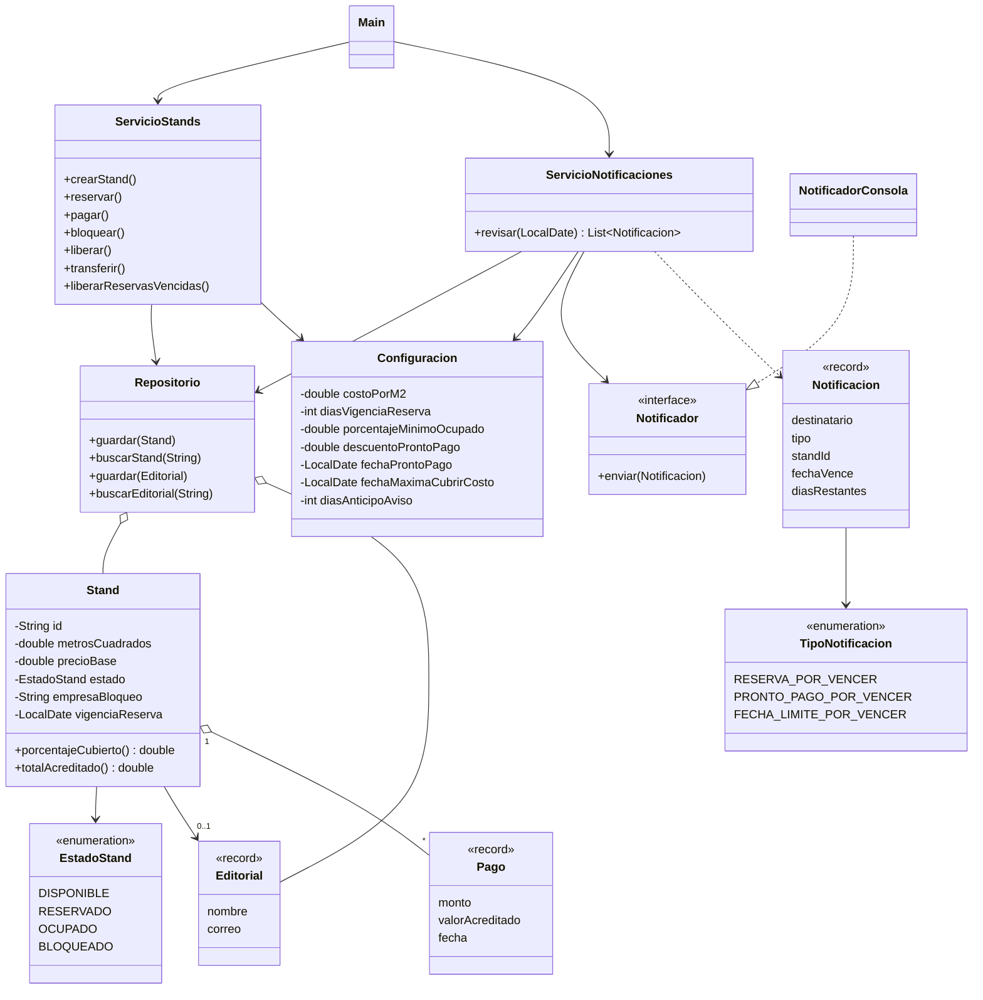

# Sistema administrativo de venta de stands

Aplicación de línea de comandos en Java 17 para administrar la venta de stands a editoriales.

## Ejecutar

```bash
javac -encoding UTF-8 -d out $(find src -name "*.java")
java -cp out com.feria.app.Main
```
(o con Maven: `mvn compile exec:java -Dexec.mainClass=com.feria.app.Main`)

Ejemplo de prueba de notificaciones:
```
> reservar A1 Planeta
> pagar A1 3645
> fecha 2026-12-01
> notificar
```

## Requisitos

**Funcionales**
- RF1. Mapear los stands con identificador, metros cuadrados, precio, y estado (disponible, reservado, ocupado, bloqueado).
- RF2. El precio de un stand se calcula con sus dimensiones: m² × costo por m² (configurable).
- RF3. Reservado: la editorial paga después; la reserva tiene tiempo de vigencia. Si vence sin llegar al porcentaje mínimo, el stand vuelve a disponible.
- RF4. Ocupado: el stand pasa a ocupado cuando el pago cubre al menos el porcentaje mínimo; se sigue pagando hasta cubrir el 100 %.
- RF5. Bloqueado: reserva especial del administrador (negociación previa a la salida del sistema). Puede regresar a disponible.
- RF6. Descuento por pronto pago: pagos hasta la fecha límite de descuento acreditan más de lo pagado; después ya no hay descuento.
- RF7. Fecha máxima para cubrir el costo total; después de ella no se aceptan pagos.
- RF8. Porcentaje mínimo configurable para pasar de reservado a ocupado.
- RF9. **Notificar a las editoriales** cuando: su reserva esté por vencer, el pronto pago esté por vencer, o la fecha límite para cubrir el costo esté por vencer.
- RF10. (Opcional) Transferencia: de bloqueado a reservado directamente a nombre de la editorial.

**No funcionales**
- RNF1. Funciona por línea de comandos.
- RNF2. Código separado en paquetes: `datos`, `negocio`, `notificaciones`, `configuracion` y `app`.
- RNF3. Los datos viven en memoria (el repositorio puede sustituirse por H2).
- RNF4. El canal de notificación es intercambiable (interfaz `Notificador`).

## Estados de un stand



## Diagrama de clases



## Subir a GitHub (mínimo 2 commits)

```bash
git init
git add pom.xml .gitignore README.md src/main/java/com/feria/datos src/main/java/com/feria/configuracion
git commit -m "Modelo de datos y configuración"
git add .
git commit -m "Lógica de negocio, notificaciones y CLI"
git branch -M main
git remote add origin <URL-DE-TU-REPO>
git push -u origin main
```
